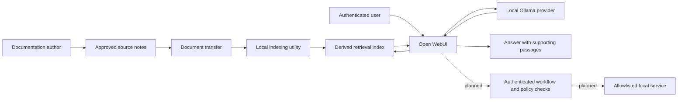

# Architecture and trust boundaries

## Recorded baseline

The supplied documentation describes an existing Open WebUI interface, local Ollama inference, approved Obsidian notes and scheduled knowledge synchronization. The architecture below is a sanitized logical model, not a host map or deployment recipe.

Solid edges describe the documented baseline. Dashed edges are proposed administrative integration. This representation omits hostnames, addresses, ports, storage mounts, knowledge identifiers and management routes.

## Data ownership

| Record | Authority | Consequence |
|---|---|---|
| Technical procedure | Approved source document | Correct the source deliberately; do not silently patch only the index |
| Retrieved content | Derived knowledge index | Check freshness and source identity before trusting environment-specific claims |
| Running service state | Service itself | A note describing a service is not a live health observation |
| Proposed operation | Future trusted workflow | Model prose cannot serve as approval or executable authority |

## Request lifecycle

1. The user asks a question in an authenticated interface.
2. Retrieval finds relevant approved content. The answer should use the returned passage and identify missing evidence.
3. Local inference produces an answer. A useful answer distinguishes documented configuration from live observations.
4. If the question needs a current check, the assistant identifies that limitation rather than asserting that it inspected the service.

The core baseline does not require the optional documentation website. Public documentation publication and internal retrieval are separate decisions.

## Runtime ambiguity

Older architecture notes name one smaller Qwen model; later acceptance records use a Qwen 8B configuration and a separate local-provider prefix. Those records do not justify a single-host deployment claim or a universal current model version. The public diagram therefore says “local Ollama provider.” Future evidence should tie each run to the exact model, provider, configuration and timestamp.

## Planned action boundary

The proposed n8n path authenticates the caller, validates a fixed action schema, checks target permissions, obtains operation-specific approval when necessary, executes a bounded adapter and verifies the result independently. It must return denied, failed or unknown when those are the actual outcomes. An uncertain write must be reconciled before retry.

This contract is a design requirement. It is not a claim that administrative tools are connected or accepted.
