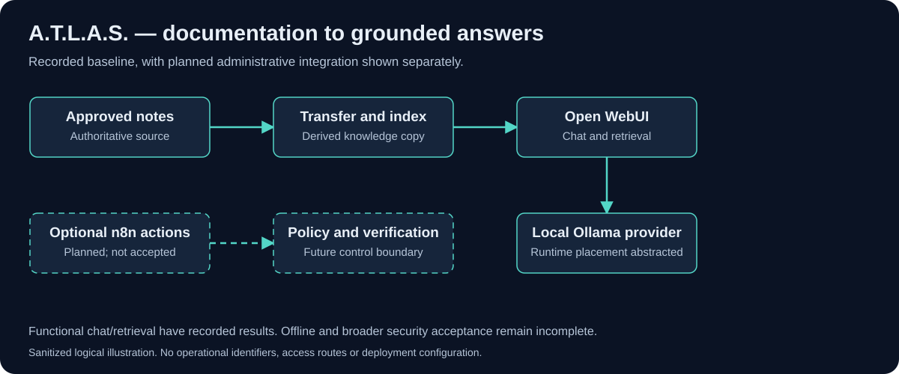

# A.T.L.A.S. AI Agent

A sanitized case study of a local documentation and troubleshooting assistant built around Open WebUI, Ollama and an Obsidian knowledge base, with a runnable synthetic evidence evaluator.

**Status:** working development baseline with documented functional acceptance results. Offline independence, broader security acceptance and administrative automation remain unfinished. Evidence reviewed October 31, 2026; this portfolio review did not operate the live assistant.

## Why I built it

Self-hosted services accumulate configuration notes, recovery procedures and dependencies that are hard to recall accurately. I wanted an assistant that could answer from approved documentation and acknowledge when a question needs a live check. A plausible answer is insufficient if it cites a document it never read or describes a corrective action as read-only.

## My contribution

My work connects the local chat interface and model runtime to an operational knowledge base, documents the synchronization path, and defines acceptance criteria for retrieval, failure handling and security. I use separate development evaluations to distinguish direct document lookup from independent investigation. The project records retain unsuccessful attempts and the scope of each later pass.

Open WebUI, Ollama, Obsidian, Nextcloud and the indexing utility are third-party components. This case study describes my integration, documentation and evaluation work; it does not claim authorship of those products.

## Architecture



Obsidian is the documentation authoring source. A synchronization path transfers approved notes to local storage, and an indexing utility supplies a derived retrieval copy to Open WebUI. Open WebUI combines retrieved content with an Ollama-backed response. The diagram abstracts local runtime placement because the evidence includes more than one configured local provider.

The source documents remain authoritative. A working chat response does not prove that the index is current, the backend route is known, or every dependency is local. Optional n8n administrative workflows are planned and are not required for the recorded chat baseline.

## What the evidence supports

| Capability | Status and scope |
|---|---|
| LAN chat and inference | LOCAL-01 recorded Pass after two successful functional runs; historical per-request backend correlation and cloud-route exclusion were not established |
| Approved-document retrieval | LOCAL-02 recorded Pass / Approved / Closed after two fresh chats returned the correct facts and relevant approved source passages |
| Knowledge synchronization | Existing scheduled pipeline documented; fresh end-to-end synchronization health was not tested in this review |
| Independent troubleshooting | Earlier diagnostic evaluation exposed unsupported references and insufficient source inspection; general reliability is not established |
| WAN-isolated operation | LOCAL-03 preflight Blocked; safe isolated setup and independent recovery were not established; no WAN block occurred |
| Administrative actions | Project-specific n8n actions are planned; no production write capability is claimed |

The more recent retrieval pass does not erase the earlier diagnostic weaknesses. It answers a narrower, better-defined question.

## Engineering decisions

1. **Keep source and index separate.** An index is a derived copy, so stale retrieval must be investigated across transfer, indexing and answer generation.
2. **Require content-level evidence.** Listing a filename is not the same as reading the passage that supports an answer.
3. **Test locality separately.** Local inference configuration does not by itself prove offline operation or exclude every external dependency.
4. **Keep diagnosis distinct from execution.** A model-generated recommendation cannot grant permission to change a service.

## Evaluate the work

Read the [architecture](ARCHITECTURE.md), [testing methodology and recorded results](TESTING.md), [engineering lessons](ENGINEERING-NOTES.md), and [limitations](LIMITATIONS.md). The [synthetic evaluation packet](evaluation/SCENARIOS.md) is usable without access to the private environment. It is an evaluation design, not a fabricated test transcript.

No operational screenshot is included. [Capture requirements](assets/SCREENSHOTS.md) define how a future safe image can be added.


## Run the code in this repository

Requires Node.js 22 or newer (validated on Node.js 24). No package installation, credentials, network connection or deployment is needed.

```text
npm test
npm run demo
```

See [source provenance, scope and evaluation](CODE-REVIEW.md). The executable code is a new AI-assisted synthetic evaluator; it does not run ATLAS or call a model. Tests exercise that standalone code, not the private system. The repository has no deployment workflow.

## Review and maintenance

The standalone tests run in a test-only GitHub Actions workflow with read-only repository access, no deployment and no production secrets. They do not establish live-system acceptance. Report a suspected sensitive-data exposure privately to the [repository owner](https://github.com/MichaelEAyotte); do not place the sensitive value in an issue.

## License

The owner-controlled original code, tests, fictional examples, documentation and diagrams in this repository are available under the [MIT License](LICENSE), copyright Michael E. Ayotte. Referenced third-party products remain under their own licenses; no product runtime is bundled or relicensed here. See the [publication scope and verification record](PUBLICATION.md).
